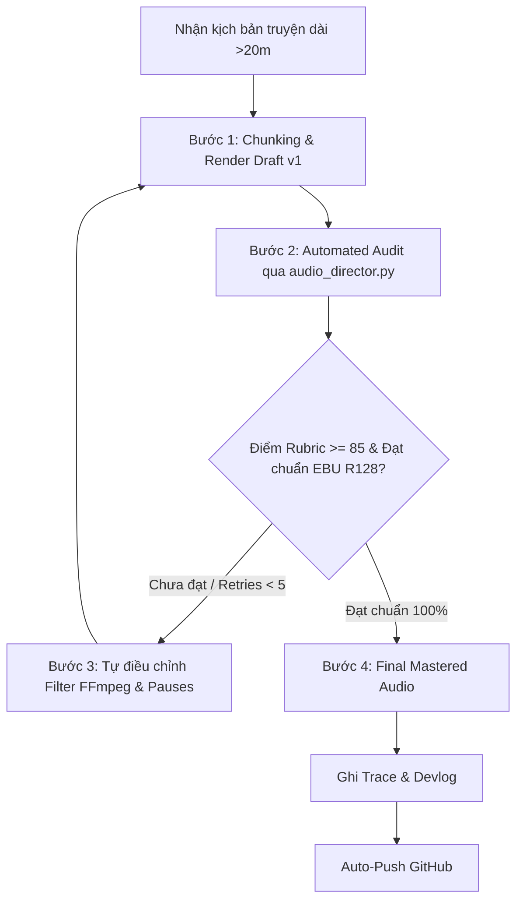

# 🎧 SKILL: AUDIOBOOK DIRECTOR & SOUND ENGINEER AI (TRUYỆN DÀI >20 PHÚT)

Skill này biến trợ lý AI thành một **Đạo diễn Âm thanh & Kỹ sư Mastering Chuyên nghiệp**. Với mọi tập truyện dài hơn 20 phút (30, 45, 60+ phút), AI không bao giờ xuất file một lèo rồi dừng lại mà bắt buộc phải phân nhịp, kiểm soát âm lượng, kiểm tra chống mỏi tai, và chạy lặp tinh chỉnh tự động.

---

## 🏗️ 1. Cấu Trúc Bộ Nhớ Kiểm Định Âm Thanh Dài

```
.agents/
└── audio_evals/
    ├── long_form_rubric.md      # Bộ tiêu chuẩn chấm điểm truyện dài (>20m, EBU R128, BGM ducking)
    ├── execution_traces.jsonl   # Lịch sử xử lý các tập dài (thời lượng, metrics, số lần retry)
    └── proposals/               # Nơi lưu các đề xuất nâng cấp code/script audio
skills/
└── audiobook-director-evaluator/
    ├── SKILL.md                 # Bộ não điều phối toàn bộ quy trình đạo diễn & mastering
    └── scripts/
        └── audio_director.py    # Suite phân tích LUFS, True Peak, và tự động Master audio
```

---

## 🎚️ 2. Bốn Tiêu Chuẩn Vàng Của Truyện Dài (>20 Phút)

1. **Phân nhịp & Quản lý phân đoạn (Chunking & Pacing):**
   - Tuyệt đối không gửi toàn bộ text >20 phút vào TTS một lần. Phải chia thành các block **3–5 phút/đoạn** (~450–750 từ).
   - Thiết lập khoảng lặng (pause) tự nhiên giữa các đoạn hội thoại (0.6s–0.9s) và chuyển cảnh (1.2s–1.8s) để tạo nhịp thở cho người nghe.
2. **Kỹ thuật âm thanh chuyên nghiệp (Audio Mastering & EBU R128):**
   - **Integrated Loudness:** Chuẩn `-16.0 LUFS` (dung sai `±1.0 LUFS`).
   - **True Peak (TP):** Tối đa `<= -1.5 dBTP` (ngăn vỡ tiếng méo âm khi nén MP3).
   - **Dải động (LRA):** `<= 11.0 LU` (âm lượng đều đặn, không phải chỉnh volume điện thoại).
   - **Audio Ducking:** BGM tự động hạ xuống `-24 dB` khi có giọng đọc và dâng nhẹ lên `-16 dB` khi có khoảng nghỉ dài.
   - **Khử rè/artifact:** Fade-in / fade-out 20ms ở điểm cắt nối để triệt tiêu tiếng pop/click.
3. **Hook 60 giây đầu (Retention):**
   - 60 giây mở màn phải có SFX mở đầu lôi cuốn hoặc tóm tắt cao trào, không để khoảng im lặng.
4. **Độ ổn định khi chạy dài (Long-run Stability):**
   - Stream audio qua disk/temp buffer, tránh dồn RAM khi xử lý audio 45–60 phút.

---

## 🔁 3. Vòng Lặp Thực Thi Lặp Tinh Chỉnh (Autonomous Iteration Loop)



### Bước 1 (Chunk & Render):
- Cắt văn bản theo cấu trúc chương hồi, mỗi chunk 3–5 phút.
- Gọi engine TTS và ghép nối mượt mà thành file voiceover thô.

### Bước 2 (Automated Audit):
- Chạy lệnh kiểm định:
  ```bash
  python .agents/skills/audiobook-director-evaluator/scripts/audio_director.py audit --input output/master_audio.mp3 --expected-min 20
  ```
- Kiểm tra các thông số: `integrated_lufs`, `true_peak_db`, `lra_lu`, và thời lượng thực tế.

### Bước 3 (Auto-Refine - Tự động sửa lỗi, tối đa 5 lần):
- Nếu phát hiện âm lượng lệch chuẩn, True Peak bị clipping, hoặc BGM quá to:
  * **TUYỆT ĐỐI KHÔNG** dừng lại hỏi người dùng.
  * Tự động áp dụng bộ lọc mastering 2-pass hoặc loudnorm của FFmpeg:
    ```bash
    python .agents/skills/audiobook-director-evaluator/scripts/audio_director.py master --input output/master_audio.mp3 --output output/master_audio_mastered.mp3 --lufs -16.0 --tp -1.5
    ```
  * Điều chỉnh âm lượng BGM xuống `-24 dB` đến `-26 dB`.
  * Chạy lại quy trình Audit đến khi đạt điểm `>= 85/100`.

### Bước 4 (Final Polish):
- Xuất file hoàn chỉnh `output/master_audio.mp3` với chất lượng phát thanh chuyên nghiệp.

---

## 📝 4. Ghi Nhận Kinh Nghiệm & Đồng Bộ GitHub

1. **Ghi trace:**
   Tự động ghi kết quả vào `.agents/audio_evals/execution_traces.jsonl`.
2. **Ghi Devlog:**
   Tạo bản ghi mới tại `docs/devlogs/devlog_YYYY-MM-DD.md` tổng kết các thông số kỹ thuật âm thanh.
3. **Commit & Push GitHub:**
   ```bash
   git add docs/devlogs/ .agents/
   git commit -m "feat(audiobook-engine): optimize long-form audio processing (>20m chunks & mastering) [YYYY-MM-DD]"
   git push origin main
   ```
