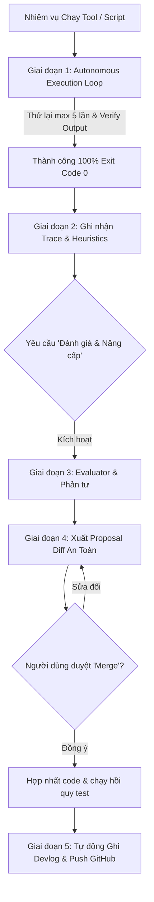

# 🔄 SKILL: TOOL LEARNER & EVALUATOR (Hệ Thống Tự Học Thực Chiến)

Skill này biến trợ lý AI thành một kỹ sư tự tối ưu hóa liên tục: thực thi lặp cho đến khi đạt chuẩn 100%, ghi nhận kinh nghiệm thực tế, định kỳ thẩm định theo benchmark, tạo bản thảo nâng cấp an toàn (RFC/Diff), tự động ghi Devlog và đồng bộ lên GitHub.

---

## 🏗️ 1. Cấu Trúc Lưu Trữ Tri Thức & Bộ Nhớ Kinh Nghiệm

```
.agents/
├── experience_memory/
│   ├── execution_traces.jsonl   # Ghi lại mọi lần chạy tool: ngữ cảnh, số lần thử, cách xử lý, kết quả
│   └── learned_heuristics.md    # Sổ tay tích lũy mẹo hay, bài học và quy tắc rút ra sau mỗi lần chạy
├── evals/
│   ├── tools_registry.json      # Danh mục các tool/script sẵn có trong workspace
│   ├── benchmark_tests.json     # Bộ test chuẩn để kiểm tra lại tool sau khi học
│   └── proposals/               # Nơi lưu các bản thiết kế nâng cấp code tool (Diff/RFC)
└── skills/
    └── tool-learner-evaluator/
        ├── SKILL.md             # Bộ não điều phối toàn bộ 5 giai đoạn
        └── scripts/
            ├── learner_ops.py    # Quản lý traces, metrics và tóm tắt trạng thái
            └── sync_to_github.py # Tự động tạo devlog, git add, commit và git push

docs/
└── devlogs/
    ├── README.md                # Mục lục tổng hợp hành trình tiến hóa của hệ thống tool
    └── devlog_YYYY-MM-DD.md     # Bản ghi chi tiết 4 mục sau mỗi chu kỳ tiến hóa
```

---

## ⚡ 2. Quy Trình 5 Giai Đoạn Chi Tiết



---

### 🔁 Giai đoạn 1: Cơ chế Thực Thi Lặp Cho Đến Khi Đạt Chuẩn (Autonomous Execution Loop)
Khi nhận lệnh chạy bất kỳ tool/script nào:
1. **Tiêu chí dừng (Exit Criteria):**
   - Lệnh kết thúc với Exit Code = 0, không có runtime crash.
   - Dữ liệu/kết quả đầu ra đáp ứng 100% yêu cầu về logic và định dạng (không rỗng, giữ trọn tiếng Việt có dấu, file audio/video mở được và đủ thời lượng).
2. **Quy trình lặp (Tối đa 5 lần thử):**
   - **Bước 1:** Thực thi tool lần 1.
   - **Bước 2:** Tự động kiểm tra file đầu ra (Verify Output).
   - **Bước 3:** Nếu FAIL hoặc CHƯA ĐẠT:
     * **TUYỆT ĐỐI KHÔNG** dừng lại để hỏi người dùng.
     * Tự đọc Traceback lỗi hoặc nguyên nhân output thiếu/sai.
     * Tự điều chỉnh tham số, regex, thuật toán hoặc sửa script tạm thời.
     * Chạy lại (Retry) và tiếp tục kiểm định.
   - **Bước 4:** Lặp lại quy trình trên cho đến khi output đạt chuẩn (chỉ dừng khi chạm ngưỡng 5 lần mà không giải quyết được mới báo cáo điểm nghẽn).

---

### 📝 Giai đoạn 2: Cơ chế Ghi Nhận Kinh Nghiệm (Sau Mỗi Lần Dùng Tool)
Sau mỗi phiên làm việc thực tế với bất kỳ tool nào:
1. **Thêm bản ghi vào `execution_traces.jsonl`:**
   ```json
   {
     "timestamp": "ISO-8601",
     "tool_name": "Tên tool và bài toán cụ thể vừa giải",
     "retry_count": 0,
     "approach_and_fixes": "Phương pháp và các bước sửa lỗi qua từng lần thử",
     "metrics": {
       "execution_time_seconds": 12.5,
       "data_processed_size": "5.4 MB"
     },
     "reflection": {
       "speed_rating": "FAST | MEDIUM | SLOW",
       "early_failure_causes": "Điểm gây lỗi ở các lần thử đầu",
       "heuristics_discovered": "Mẹo hay rút ra để phòng ngừa"
     }
   }
   ```
2. **Cập nhật Heuristics:**
   Bổ sung ngay quy tắc mới vào `.agents/experience_memory/learned_heuristics.md` tương ứng từng module.

---

### 🔍 Giai đoạn 3: Cơ chế Thẩm Định & Phản Tư (Evaluator)
Kích hoạt khi người dùng yêu cầu: **"Đánh giá và nâng cấp"** hoặc sau một đợt chạy hàng loạt:
1. Đọc lại `execution_traces.jsonl`, `tools_registry.json` và `learned_heuristics.md`.
2. Đối chiếu mã nguồn tool hiện tại với kinh nghiệm:
   - Những lỗi từng khiến tool phải retry nhiều lần đã được xử lý triệt để trong code gốc chưa?
   - Có đoạn code nào lặp lại nên đóng gói vào `src/utils/` không?
   - Có logic nào thừa thãi hoặc gây chậm chạp không?

---

### 🛡️ Giai đoạn 4: Tự Tái Học và Nâng Cấp An Toàn (Self-Upgrade)
1. **Xuất file đề xuất:** Tạo file `.agents/evals/proposals/proposal_YYYYMMDD_<tool_name>.md`.
2. **Quy tắc an toàn cốt lõi:**
   - **TUYỆT ĐỐI KHÔNG** tự ý ghi đè vào file mã nguồn gốc.
   - Trình bày bản Diff rõ ràng (`diff` blocks) và phân tích rủi ro.
3. **Hợp nhất (Merge):**
   - Chỉ khi người dùng xác nhận (`Duyệt` / `Merge`), AI mới tiến hành chỉnh sửa code vào file gốc.
   - Chạy toàn bộ test suite (`python -m unittest discover tests`).

---

### 🚀 Giai đoạn 5: Tự Động Ghi Devlog, Commit và Push Lên GitHub
Khi hoàn thành một chu kỳ học hoặc giải quyết xong bài toán lớn:
1. **Tạo Devlog:**
   - Tự động sinh `docs/devlogs/devlog_YYYY-MM-DD.md` với 4 mục chuẩn:
     1. Bối cảnh & Vấn đề thực tế (Context)
     2. Bài học rút ra (Learned Heuristics)
     3. Thay đổi kỹ thuật (Changelog & Technical Improvements)
     4. Benchmark & Hiệu năng
2. **Cập nhật mục lục:**
   - Thêm dòng mới vào bảng tại `docs/devlogs/README.md`.
3. **Đồng bộ GitHub tự động (`sync_to_github.py`):**
   - Kiểm tra an toàn loại trừ `.env`, credentials.
   - Chạy lệnh:
     ```bash
     python .agents/skills/tool-learner-evaluator/scripts/sync_to_github.py --tool <tool_name>
     ```
   - Script tự động `git add`, `git commit -m "feat(tool-evolution): upgrade <tool-name> and update devlog [YYYY-MM-DD]"`, và `git push origin <current-branch>`.
   - Nếu gặp conflict, tự động kích hoạt `git pull --rebase` rồi push lại. Báo cáo hash commit và link GitHub.
